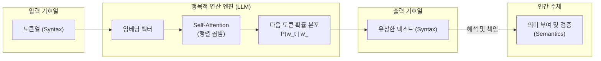

## 핵심 주장

[[기호는 어떻게 생각의 보조 도구에서 계산 엔진이 되었는가]]는 인간 지성사에서 기호(Symbol / Sign)의 위상이 단순한 기억 보조 도구에서 사유의 본질을 구성하고 추론을 대리하는 계산 엔진으로 근본적인 전회를 겪은 400년의 계보를 종합한다. 이 계보의 앞자리에는 [[거듭제곱 법칙을 알고도 지수 기호는 왜 늦게 생겼는가]]가 있다. 그 글은 거듭제곱 법칙을 말로 아는 일과, 밑과 지수를 갈라 새 수를 만드는 표기 규칙을 서로 다른 문제로 다룬다. 17세기 [[토머스 홉스]](Thomas Hobbes)는 뇌의 인지적 유동성과 망각을 보완하기 위한 감각적 '외장 메모리'로서 기호를 규정했으나, [[고트프리트 빌헬름 라이프니츠]](Gottfried Wilhelm Leibniz)는 데카르트의 천각형(Chiliagon) 논증을 전복하며 감각적 심상이나 내용 직관이 부재하더라도 기호 대입과 형식적 조작 규칙만으로 참된 인식을 산출하는 **[[맹목적 사고와 기호적 인식|맹목적 사고(Cogitatio Caeca)]]**를 정초했다.

이러한 기호 형식주의는 19~20세기 [[조지 불]](George Boole)의 논리 대수화, [[앨런 튜링]](Alan Turing)의 보편 기계, [[클로드 섀넌]](Claude Shannon)의 스위칭 회로를 거치며 물리적 반도체 소자로 완전히 육화되었다. 나아가 21세기 거대언어모델(LLM)은 고차원 연속 벡터 공간의 행렬 곱셈을 통해 인간 언어를 유창하게 생성하지만, 그 내부에는 대상에 대한 지향성이나 의미 이해가 전무하다는 점에서 라이프니츠의 맹목적 기호 조작이 도달한 통계적 궁극이자 [[존 설]](John Searle)의 [[중국어 방과 구문-의미 간극|'중국어 방(Chinese Room)']]의 현실적 실현이다. 기호 조작이 기억의 외주화에서 연산의 외주화, 마침내 '의미 구성의 외주화'로 나아감에 따라, 자동화는 인간의 인지 노동을 소멸시키는 것이 아니라 결과 계약에 대한 **[[검증 노동]](Verification Labor)**으로 이동시킨다.

## 1. 홉스의 인지 진단과 계산주의 혁명

토머스 홉스는 서양 근대 사상사에서 마음의 작용을 신비로운 비물질적 영혼이 아닌 외부 물질의 기계적 운동으로 파악한 최초의 철학자 중 한 명이다. 홉스는 《물체론(*Elementorum Philosophiae Sectio Prima De Corpore*, 1655)》에서 인간 인지 과정의 한계를 냉철하게 진단했다(*De Corpore* I, 2, 1). 뇌 속에서 일어나는 감각과 사념의 흐름은 극도로 유동적(fluid)이고 일시적이어서, 물리적 닻(sensible moniments) 역할을 하는 감각적 매개체가 주어지지 않으면 복잡한 수(quantity), 색채, 인과적 사건의 계기 순서를 장기적으로 유지하거나 재현할 수 없다.

이 인지적 한계를 돌파하기 위해 홉스는 감각 기호의 기능을 개인적 기억과 사회적 소통이라는 두 축으로 엄격히 구분했다.

- **표지(Mark / 라틴어: Nota)**: 자기 자신의 망각을 방지하고 과거의 사념을 자의적으로 재환기하기 위해 개인이 임의로 고안한 사적(private) 물리 장치다(*notae mihi ipsi ad reminiscendum*).
- **신호(Sign / 라틴어: Signum)**: 타인 및 사회 공동체에 자신의 사념과 지식을 가르치고 소통하기 위해 사용하는 공적(public) 사회적 규약이다(*signa erga alios ad docendum*).

단어(words)나 이름(names)은 일차적으로 개인이 자신의 생각을 붙들어 매는 사적 표지로 출발하며, 이것이 사회적 약속과 문법적 질서 속에서 결합될 때 비로소 타인에게 생각을 전달하는 신호로 전환된다.

나아가 홉스는 《물체론》 제1부 〈계산 혹은 논리학(Computatio sive Logica)〉 1장 2절에서 계산주의 인지과학의 모태가 되는 선언을 남겼다.

> "추론이란 곧 산술의 계산과 같이, 더하고 빼는 정신의 작용이다." (*Per ratiocinationem autem intelligo computationem*)

홉스에게 추론(ratiocination)은 수량의 계산에 국한되지 않는다. 수의 곱셈이 덧셈의 누적이고 나눗셈이 뺄셈의 반복이듯, 인간의 모든 지적 추론은 개념들의 덧셈(종합/합성, composition)과 뺄셈(분석/분해, resolution)으로 환원된다. 예를 들어 '물체'라는 기본 관념에 '생명'을 더하고 다시 '이성'을 더함으로써 '사람 = 물체 + 생명 + 이성'이라는 복합 개념을 산출하고, 반대로 '사람'에서 '이성'을 제거하면 '동물 = 사람 - 이성'이라는 유개념이 도출된다.

> [!WARNING] 모순 발견: 무언의 추론(Silent Reasoning / Cogitatio Tacita)과 기호 필수론의 충돌
> 
> 홉스는 기호가 인간 망각을 방지하고 복합 사유를 수행하는 데 필수적이라고 역설하면서도, 《물체론》 제1부 1장 3절에서 단어의 개입 없이 머릿속 관념만으로 참된 인식을 전개하는 **'무언의 추론(Silent Reasoning / *Cogitatio Tacita*)'**을 순수한 사유의 형태로 인정하는 이론적 모순을 드러냈다.
> 
> 현대 언어철학자 마르셀로 다스칼(Marcelo Dascal)은 이를 근거로 홉스에게 기호란 사유 자체를 구성하는 엔진이 아니라 밥을 뜨는 숟가락과 같은 외재적 보조 도구(external aid)에 불과했다고 비판했다. 다스칼은 윌리엄 닐(William Kneale)이 홉스를 형식주의적 기호 조작의 선구자로 오독했다고 공박했다.
> 
> 그러나 이상명(2016, [[홉스와 라이프니츠: 기호의 기능]])의 면밀한 원전 재검토에 따르면, 닐 역시 홉스가 기호 조작으로서의 추론 체계를 완성했다고 주장한 것이 아니라 라이프니츠에게 나아갈 방향을 "시사(suggest)"했다고 신중히 서술했다. 홉스의 무언의 추론은 계산이라는 행위가 수치적 산술에 종속되지 않는다는 점을 일상적 심상 경험으로 입증하려던 과도기적 논증이었다. 결국 홉스는 기호를 일상 자연언어의 범주에 묶어두었으며, 기호의 형식적 규칙 조작만으로 내용 직관 없이 새로운 진리를 연역하는 완전한 형식주의 계산 체계로 도약하지는 못했다.

## 2. 라이프니츠의 도약: 천각형 역설과 맹목적 사고(Cogitatio Caeca)

고트프리트 빌헬름 라이프니츠는 홉스의 '기호 보조 도구관'을 단호히 거부하고, 기호가 인간 사유의 내재적 구성 엔진임을 선언했다.

> "인간의 모든 추론은 어떤 부호나 기호를 통해서 완성된다. […] 모든 추론은 기호의 사용으로 구성된다." (*Fundamenta calculi ratiocinatoris*, 1679)

라이프니츠의 인식론적 혁명은 1684년 발표한 논문 《인식, 진리 그리고 관념에 관한 성찰(*Meditationes de Cognitione, Veritate et Ideis*, ref-144)》에서 체계화되었다. 라이프니츠는 인간 지성의 유한성을 직시했다. 복합 개념을 이루는 모든 단순 요소를 '단번에 동시에(simul)' 직관할 수 있는 완전하고 판명한 인식(Cognitio Intuitiva)은 오직 무한한 신(God)에게만 가능하다. 유한한 인간은 복잡한 개념을 마주할 때 그 내용 요소를 한순간에 머릿속에 표상할 수 없다.

인간의 직관 불가능성을 입증하기 위해 라이프니츠는 데카르트(René Descartes)의 **천각형(Chiliagon)** 사고실험을 전복했다. 데카르트는 《성찰(Meditationes de Prima Philosophia, 1641)》 제6명상에서 천각형을 순수 오성과 감각적 상상력의 차이를 보여주는 사례로 제시했으나, 여전히 직관적 명증성을 인식의 최우선 기준으로 삼았다. 반면 라이프니츠는 천각형의 기하학적 성질을 다룰 때 인간 머릿속에 떠오르는 심상(imago)이 매끄러운 원과 구별할 수 없는 백지상태라는 점에 주목했다.

인간은 변이 1,000개인 천각형의 형상을 전혀 상상하거나 직관하지 못한다. 그럼에도 불구하고 인간은 천각형에 대한 완전하고 엄밀한 기하학적 지식을 다룰 수 있다. 구체적 심상이 비어 있는 자리에 숫자 '1,000'이라는 기호(character)를 대입하고, n각형의 내각 총합 공식인 `180° × (n - 2)`의 규칙을 적용하여 `180° × (1000 - 2) = 179,640°`라는 정확한 진리를 오차 없이 도출한다.

라이프니츠는 구체적 내용에 대한 직관적 심상 없이, 기호 체계의 형식적 조작 규칙에 의존하여 진행되는 사유를 **'맹목적 사고(Cogitatio Caeca)'** 또는 **'기호적 사고(Cogitatio Symbolica)'**라고 명명했다. 나아가 라이프니츠는 관념(Idea)의 정의 자체를 전복했다. 관념은 머릿속에 실시간으로 재생되는 그림이나 심상이 아니라, 대상을 파악하고 모순 없이 조작할 수 있는 **'사유할 수 있는 잠재적 능력(*facultas cogitandi*)'**이다. 따라서 심상이 부재하더라도 기호의 적법한 조작 능력이 확보된다면 참된 사유가 성립한다.

진리의 기준 역시 전환되었다. 진리는 관념과 사물의 신비로운 신적 일치가 아니라, **기호가 정의된 형식 규칙에 따라 모순 없이 조작되었는가(추론의 형식적 적법성, Formal Validity)**로 치환되었다.

라이프니츠는 이 맹목적 사고를 실현하기 위해 [[보편 기호법과 사유의 계산]]이라는 이원적 시스템을 구상했다.
1. **보편 기호법(Characteristica Universalis)**: 모든 인간 지식을 소수의 기본 관념(사유의 알파벳, *Alphabetum cogitationum humanarum*)으로 환원하고 고유한 기호나 특성수(Characteristic Numbers)를 부여하는 데이터 표현 체계.
2. **사유의 계산(Calculus Ratiocinator)**: 보편 기호들을 규칙에 따라 기계적으로 연산·변환하여 참과 거짓을 판정하는 추론 알고리즘.

학문적 분쟁이 발생했을 때 논쟁 대신 "자, 계산해 봅시다!(Calculemus!)"를 외치며 펜을 들 수 있으리라는 라이프니츠의 이상은, 1703년 0과 1의 두 기호만으로 모든 수와 논리를 연산하는 [[이진법]](*Explication de l'Arithmétique Binaire*, ref-145) 연구와 사칙연산 기계인 단차 계산기(Stepped Reckoner)의 물리적 제작으로 구체화되었다.

## 3. 기호의 물리적 육화: 불 대수에서 튜링 기계와 섀넌의 논리 게이트로

라이프니츠의 맹목적 사고는 19세기와 20세기를 거치며 철학적 형이상학의 외피를 벗고 물리적 공학 장치로 육화(Incarnation)되었다.

| 시대 및 인물 | 핵심 기여 | 기호 조작의 진화 단계 | 근거 문헌 |
|---|---|---|---|
| **조지 불 (1854)** | [[불 대수]](Boolean Algebra): 참(1)과 거짓(0)의 대수화 | 논리를 수학적 방정식(`x² = x`)과 기호 연산으로 전환 | [[An Investigation of the Laws of Thought]] |
| **앨런 튜링 (1936)** | [[보편 튜링 기계]](Universal Turing Machine) | 테이프 위의 기호 조작 규칙으로 하드웨어와 소프트웨어의 존재론적 분리 확립 | [[On Computable Numbers with an Application to the Entscheidungsproblem]] |
| **클로드 섀넌 (1937/1938)** | 스위칭 회로와 불 대수의 1:1 매핑 | 추상적 기호 연산을 물리적 릴레이·전자 스위치 전압 상태로 실체화 (1937년 석사논문, 1938년 출판) | [[A Symbolic Analysis of Relay and Switching Circuits]] |
| **존 배커스 (1957)** | [[The FORTRAN Automatic Coding System]] | 고수준 수학적 기호 표현을 실행 가능한 기계 명령어로 자동 번역 | [[The FORTRAN Automatic Coding System]] |

1. **논리의 대수화**: 조지 불은 1854년 《사고의 법칙 연구(*An Investigation of the Laws of Thought*)》에서 인간 사고의 논리적 법칙을 순수 대수학적 기호 체계로 변환했다. 명제의 참(True)과 거짓(False)을 숫자 1과 0에 대응시키고 논리곱(AND)을 곱셈으로, 논리합(OR)을 덧셈으로 다룸으로써, 추론은 직관적 의미와 완전히 분리된 순수 기호 대수 연산이 되었다.
2. **보편 기계와 소프트웨어의 탄생**: 앨런 튜링은 1936년 테이프 위에 적힌 이산적 기호들을 읽고, 쓰고, 헤드를 이동하는 단순한 기계 모형을 고안했다. 튜링의 결정적 통찰은 기계의 동작 규칙 자체를 기호화하여 테이프에 데이터로 기록할 수 있다는 점, 즉 [[보편 튜링 기계]]의 가능성에 있었다. 이로써 고정된 물리적 배선 없이도 테이프 위의 기호열(프로그램)만 교체하면 임의의 연산을 대행하는 범용 컴퓨팅이 성립했으며, 물리적 장치(하드웨어)와 기호적 지시문(소프트웨어)의 존재론적 분리가 완성되었다.
3. **스위칭 회로를 통한 물리적 육화**: 클로드 섀넌은 1937년 MIT 석사학위 논문(1938년 학술지 출판)에서 전화 교환기에 쓰이던 릴레이 스위치의 개폐(ON/OFF) 상태가 불 대수의 1과 0에 완벽히 사상(mapping)됨을 수학적으로 증명했다. 이 발견으로 기호 연산은 종이 위의 수학을 넘어 전류가 흐르고 차단되는 전자 회로의 물리적 현상으로 전환되었으며, 현대 반도체 논리 게이트(AND, OR, NOT)의 모태가 되었다.

> [!NOTE] 17세기 형이상학적 선구와 20세기 공학 구현의 경계
> 
> 라이프니츠의 보편 기호법은 세계의 실재적 본질을 담고 있는 '진정한 문자(Real Characters)'를 발견하려는 신학적·형이상학적 기획이었다. 반면 튜링과 섀넌의 20세기 공학적 기호 조작은 기호의 실재론적 의미를 완전히 탈색시켰다. 컴퓨터는 0과 1이 무엇을 가리키는지 알지 못하며 알 필요도 없다. 기호는 단지 전압의 고저(High/Low)라는 물리적 상태에 불과하며, 기계는 의미를 이해하지 못한 채 엄밀한 전자기 법칙에 따라 상태를 갱신할 뿐이다. 라이프니츠가 꿈꾼 맹목적 사고는 형이상학적 직관을 제거한 물리적 스위칭의 맹목성으로 달성되었다.

## 4. 거대언어모델(LLM)의 대역설과 중국어 방

20세기 중반 인공지능 연구는 라이프니츠와 홉스의 기획을 직접 계승하여 명시적인 기호 조작 규칙과 논리 추론 엔진을 구축하려던 고전적 기호주의(GOFAI: Good Old-Fashioned AI)로 출발했다. 그러나 기호주의 AI는 기호와 실세계 감각 경험 사이의 연결고리를 설명하지 못하는 기호 착지 문제(Symbol Grounding Problem)와 실세계의 무수한 변화 조건을 규칙으로 기술할 수 없는 프레임 문제(Frame Problem)에 부딪혀 정체되었다.

현대 인공지능의 주도권은 기호주의를 넘어 대규모 데이터와 통계적 가중치를 학습하는 연결주의(Connectionism), 특히 2017년 이후의 트랜스포머(Transformer) 기반 신경망으로 넘어갔다. 그러나 바로 이 지점에서 컴퓨터 사상사 최대의 역설이 발생한다.

### 연속 벡터 공간과 통계적 맹목성의 극대화

거대언어모델(LLM)의 내부 연산은 명시적인 논리 규칙이 아니다. 수억~수천억 개의 매개변수로 구성된 고차원 연속 벡터 공간(Continuous Vector Space)에서 부동소수점 행렬 곱셈과 자기주의(Self-Attention) 연산을 수행하며, 이전 토큰열이 주어졌을 때 다음 토큰이 나타날 조건부 확률 분포 `P(w_t | w_{<t})`를 계산할 뿐이다.

그러나 이 통계적 수치 연산이 빚어내는 최종 출력물은 인간의 자연언어 기호열이다. 모델은 시를 짓고, 복잡한 법률 문서를 요약하며, 정교한 컴퓨터 코드를 작성한다. 내부에는 대상에 대한 지향성(Intentionality), 감각적 심상, 의식적 직관이 전무함에도 불구하고, 출력물은 지적 유창함의 극치를 달린다. 이것은 라이프니츠의 **맹목적 사고(Cogitatio Caeca)가 도달한 궁극의 통계적 형태**다. 기계는 내용을 직관하지 않고도 기호와 기호 사이의 통계적 규칙과 문맥적 상대 위치만을 조작하여 인간 지성의 외형을 완벽히 모사한다.

### 21세기 중국어 방의 실현

이러한 LLM의 비약은 [[존 설]](John Searle)이 1980년 《[[Minds, Brains, and Programs]]》(ref-146)에서 제기한 **[[중국어 방과 구문-의미 간극|'중국어 방(Chinese Room)']]** 사고실험을 21세기에 그대로 실현한 것이다.

중국어를 모르는 방 안의 영어 화자가 방대한 영어 규칙서(트랜스포머 가중치 매개변수)를 보고 슬롯으로 들어온 한자 기호(입력 프롬프트)의 형태를 대조하여 적절한 한자 기호(응답 텍스트)를 밖으로 내보낸다. 방 밖의 관찰자는 방 전체가 중국어를 완벽히 이해한다고 착각하지만, 방 안의 사람도, 규칙서도, 방 전체 시스템도 중국어의 의미(Semantics)를 1%도 이해하지 못한다.

설의 핵심 명제는 다음과 같다: **"구문론(Syntax)은 의미론(Semantics)을 낳기에 충분하지 않다."**

LLM은 고도로 세련된 구문론적 토큰 조작 기계일 뿐이며, 생성된 문장에 진정한 의미와 맥락적 타당성을 부여하고 그것을 현실 세계와 연결하는 주체는 여전히 기호열을 읽고 검증하는 인간이다.

## 5. 일상의 맹목적 사고와 '의미의 외주화'

맹목적 기호 조작은 최첨단 AI 연구실에만 머물지 않는다. 현대 정보 사회를 지탱하는 가장 보편적인 소프트웨어인 [[스프레드시트]](Excel) 역시 맹목적 사고의 일상적 구현체다.

사용자가 스프레드시트의 셀에 `=A1 + B1`이나 `=SUM(C1:C100)`이라는 수식을 입력할 때, 사용자는 구체적인 숫자가 무엇인지 머릿속에 떠올리지 않는다. 기호의 자리를 내용으로부터 비워두고 참조 관계와 계산 규칙만을 선언하는 것이다. 이후 어떤 숫자가 셀에 입력되든 소프트웨어 엔진은 사용자의 직관 없이도 정의된 규칙에 따라 결과를 자동 재계산한다. 이 '내용의 비움'이야말로 인간이 수백만 건의 회계 장부를 오류 없이 다룰 수 있게 하는 힘이다.

### 외주화의 3단계 계보

기호 조작의 사상사는 인간이 자신의 정신 활동을 외부 인공물에 체계적으로 넘겨온 '외주화(Outsourcing)'의 역사로 정식화할 수 있다.

| 외주화 단계 | 시기 및 대표 사상가 / 도구 | 위임 대상 | 남는 인간 책임 |
|---|---|---|---|
| **1단계: 기억의 외주화** | 17세기 [[토머스 홉스]] | 뇌의 유동성과 망각 극복 → 물리적 표지(Nota)와 문자 체계로 기억 보존 | 표지 제정과 기호의 일관된 참조 |
| **2단계: 연산의 외주화** | 17~20세기 라이프니츠·불·컴파일러·스프레드시트 | 직관 없는 규칙 조작 → 사유의 계산·논리 회로·고수준 언어 컴파일러로 절차 실행 위임 | 수식 선언과 제약 조건 정의 |
| **3단계: 의미 구성의 외주화** | 21세기 거대언어모델(LLM) | 개념 합성 및 담론 구성 → 초거대 신경망의 통계적 기호 생성으로 텍스트·코드 생성 위임 | 의미 맥락 점검과 [[검증 노동]] |

1. **기억의 외주화 (1단계, 홉스)**: 인지적 유동성과 망각의 한계를 물리적 표지와 신호 체계에 기록하여 인간 뇌 밖의 외장 메모리로 위임했다.
2. **연산의 외주화 (2단계, 라이프니츠에서 컴파일러·스프레드시트까지)**: 기호의 구체적 내용을 비워두고, 사유의 계산, 포트란 컴파일러([[The FORTRAN Automatic Coding System]], ref-016), 스프레드시트 수식처럼 저수준 기계 연산과 절차 실행을 규칙 기반 시스템에 위임했다.
3. **의미 구성의 외주화 (3단계, 생성형 AI)**: 이제 인간은 개념의 합성, 논리적 문장 구성, 문서 요약, 프로그램 코드 작성이라는 고차원적 상징 조작 자체를 인공신경망의 확률적 기호 생성 엔진에 통째로 위임하기 시작했다.

### 인간에게 남겨진 결과 계약: 검증 노동과 책임 귀속

자동화는 노동을 허공으로 소멸시키는 마법이 아니며, 인지 노동의 위치를 이동시킬 뿐이다([[자동화는 계산 노동을 없애는가 책임을 옮기는가]]). 의미 구성이 외주화될수록, 시스템과 인간 사이의 결과 계약(Result Contract)은 다음과 같은 4단계 경계로 재편된다.

1. **의도 표현(Specification)**: 인간이 요구와 제약 조건을 프롬프트와 컨텍스트로 기계에 전달한다.
2. **기호 생성(Generation)**: 기계가 맹목적 통계 규칙에 따라 유창한 텍스트와 코드 후보를 합성한다.
3. **결과 검증(Verification)**: 기계가 쏟아낸 출력이 도메인 지식, 사실성, 논리적 무모순성, 안전성 기준에 부합하는지 시험하고 선별한다.
4. **책임 귀속(Accountability)**: 시스템 오작동이나 환각(Hallucination), 법적·윤리적 문제 발생 시 책임을 지고 롤백하거나 수정한다.

기계가 '맹목적 기호 조작의 대가'로 군림할수록, 인간에게 남겨지는 본질적 과업은 **[[검증 노동]](Verification Labor)**이다. 기호의 의미론을 갖추지 못한 기계는 자신의 출력이 참인지 거짓인지에 대해 책임질 수 없다. 400년 전 라이프니츠가 천각형의 심상을 비워두고 기호 연산의 형식적 적법성으로 진리를 도출했듯, 현대인은 기계가 생성한 기호열의 의미론적 무모순성을 최종 판정하고 보증해야 하는 계약의 종착지에 서 있다.

## 관계

| 관계 | 대상 | 설명 | 근거 |
|---|---|---|---|
| synthesizes | [[기호 조작]] | 홉스의 가감 연산과 튜링·섀넌의 회로 매핑을 거쳐 기호를 맹목적 상태 변환 엔진으로 확장한 계보를 종합한다. | [[Elementorum Philosophiae Sectio Prima De Corpore]], [[Meditationes de Cognitione, Veritate et Ideis]], [[A Symbolic Analysis of Relay and Switching Circuits]] |
| synthesizes | [[맹목적 사고와 기호적 인식]] | 내용 직관의 부재를 기호 대입과 형식적 적법성으로 해결한 인식론적 도약을 분석한다. | [[Meditationes de Cognitione, Veritate et Ideis]], [[홉스와 라이프니츠: 기호의 기능]] |
| synthesizes | [[보편 기호법과 사유의 계산]] | 개념 표상 체계와 추론 알고리즘의 분리가 현대 소프트웨어/하드웨어 분리로 이어지는 계보를 종합한다. | [[홉스와 라이프니츠: 기호의 기능]], [[Explication de l'Arithmétique Binaire]] |
| synthesizes | [[중국어 방과 구문-의미 간극]] | 현대 LLM의 통계적 기호 처리와 인간에게 남겨진 의미 검증 책임을 연결한다. | [[Minds, Brains, and Programs]] |
| synthesizes | [[자동화는 계산 노동을 없애는가 책임을 옮기는가]] | 기억의 외주화, 연산의 외주화, 의미의 외주화라는 3단계 위임 구조로 자동화 책임을 종합한다. | [[홉스와 라이프니츠, 기호에서 AI까지]] |

## 출처

<!-- wiki-v2:evidence-start -->
### 근거 ID
- `ref-143`
- `ref-144`
- `ref-145`
- `ref-146`
- `ref-142`
- `src-007`
- `ref-030`
- `ref-009`
- `ref-008`
- `ref-016`
<!-- wiki-v2:evidence-end -->

- [[Elementorum Philosophiae Sectio Prima De Corpore]]
- [[Meditationes de Cognitione, Veritate et Ideis]]
- [[Explication de l'Arithmétique Binaire]]
- [[Minds, Brains, and Programs]]
- [[홉스와 라이프니츠: 기호의 기능]]
- [[홉스와 라이프니츠, 기호에서 AI까지]]
- [[An Investigation of the Laws of Thought]]
- [[On Computable Numbers with an Application to the Entscheidungsproblem]]
- [[A Symbolic Analysis of Relay and Switching Circuits]]
- [[The FORTRAN Automatic Coding System]]

## 관련 항목

- [[기호 조작]] — 기호를 물리적·추상적 상태 기계의 규칙 체계로 다루는 근본 개념을 다룬다.
- [[맹목적 사고와 기호적 인식]] — 내용 직관 없이 기호 대입과 형식적 조작만으로 진리를 도출하는 라이프니츠의 인식론적 원리를 다룬다.
- [[보편 기호법과 사유의 계산]] — 지식의 체계적 기호 표상과 기계적 추론 알고리즘의 결합을 다룬다.
- [[중국어 방과 구문-의미 간극]] — 기호 조작의 통계적 극대화인 현대 LLM과 의미 이해의 본질적 한계를 비교 분석한다.
- [[자동화는 계산 노동을 없애는가 책임을 옮기는가]] — 기호 조작의 외주화에 따라 인간에게 재배치되는 검증 노동과 결과 계약을 다룬다.
